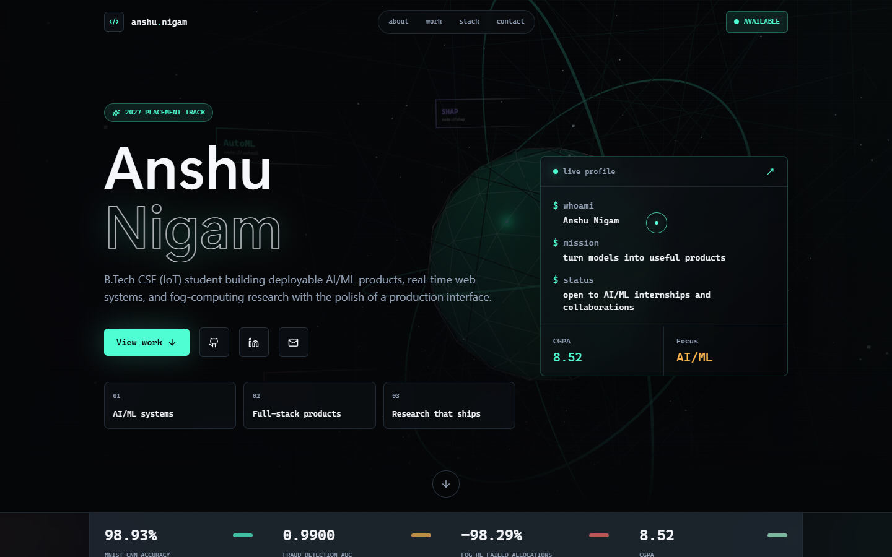

# Anshu Nigam portfolio

[](https://github.com/anshunigam-trigger/portfolio/actions/workflows/ci.yml)



This is Anshu Nigam's recruiter-focused portfolio for SWE and AI/ML internship applications. It presents three evidence-led projects, a lightweight animated background, a proof strip for resume and profiles, and static project case-study pages.

## What exists

- Recruiter-first hero with target role, proof links, and three server-rendered metrics.
- HARD-RL, fraud detection, and AutoBench case studies ordered from `data/projects.js`.
- Dedicated static routes at `/projects/[id]` with problem, approach, results, tradeoffs, and links.
- Reduced-motion-aware particle field and no 3D scene or Three.js runtime.
- Mailto contact flow with prefilled subject and message.
- Open Graph image, canonical metadata, JSON-LD Person schema, sitemap, and robots routes.

## Stack

Versions below come from `package.json`.

| Area | Version or package |
| --- | --- |
| Framework | Next.js 16.2.12 |
| UI | React 19.2.8, React DOM 19.2.8 |
| Styling | Tailwind CSS 3.4.4, global CSS |
| Motion | Framer Motion 12.42.2, Lenis 1.3.25 |
| Icons | Lucide React 1.28.0, React Icons 5.7.0 |
| Fonts | Inter, Space Grotesk, JetBrains Mono via Fontsource |
| Deployment | Vercel |

## Structure

```text
app/
  layout.js                 metadata, JSON-LD, fonts, shell
  page.js                   home route
  projects/page.js          project listing
  projects/[id]/page.js     static case-study routes
  opengraph-image.jsx       1200 x 630 generated social image
src/components/
  sections/                 hero, projects, research, about, contact, proof
  experience/               background motion and particle field
  animations/               small client animation helpers
data/projects.js            project, stat, and TODO-safe content source
public/resume.pdf           resume asset
scripts/                    encoding and data checks
```

## Run locally

```bash
npm ci
npm run dev
```

Open `http://localhost:3000`.

Useful checks:

```bash
npm test
npm run lint
npm run build
```

## Edit portfolio content

Project fields, proof URLs, result baselines, and hero stats live in [`data/projects.js`](data/projects.js). Unknown facts are literal `TODO:` values and are hidden by the UI. Fill the corresponding checklist in [`TODO_FOR_ANSHU.md`](TODO_FOR_ANSHU.md) before publishing claims.

## Deployment

The deployed site is [portfolio-self-xi-73.vercel.app](https://portfolio-self-xi-73.vercel.app). Deploy the `portfolio-recruiter-upgrade` branch as a preview, then merge only after the CI workflow passes.

## Lighthouse results

| Viewport | Performance | Accessibility | Best Practices | SEO |
| --- | --- | --- | --- | --- |
| Mobile | TODO: run Lighthouse | TODO: run Lighthouse | TODO: run Lighthouse | TODO: run Lighthouse |

## Future improvements

- Add the real project repository, demo, media, paper, and baseline URLs listed in `TODO_FOR_ANSHU.md`.
- Add verified experience and problem-solving data when available.

## Contact

- Email: [nigamanshu188@gmail.com](mailto:nigamanshu188@gmail.com)
- GitHub: [anshunigam-trigger](https://github.com/anshunigam-trigger)
- LinkedIn: [anshu-nigam](https://linkedin.com/in/anshu-nigam)
